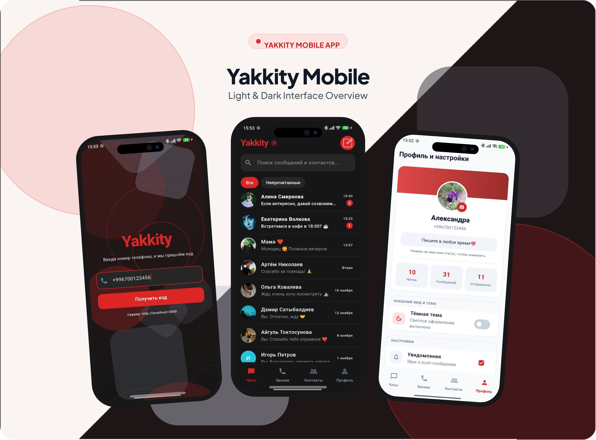
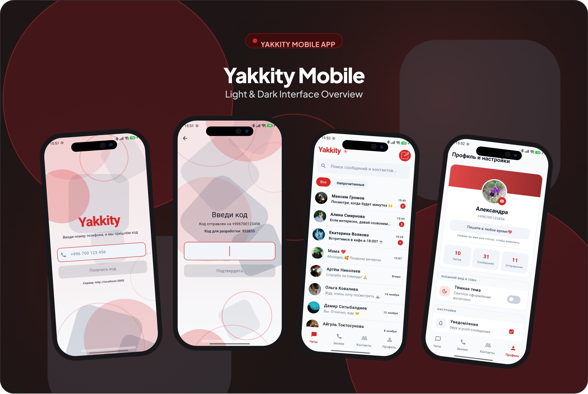
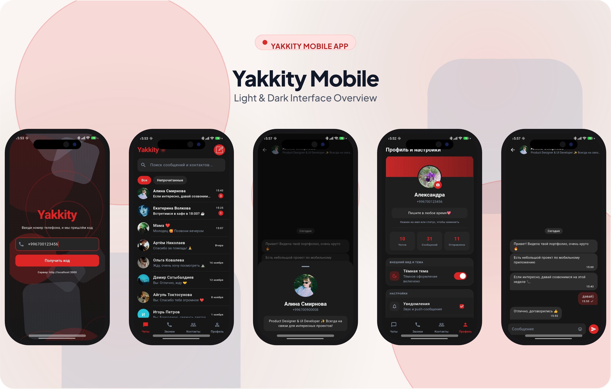
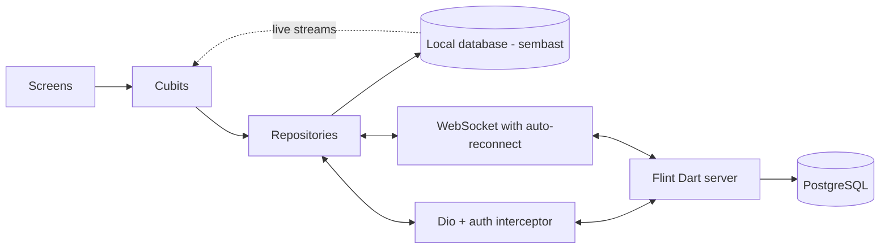
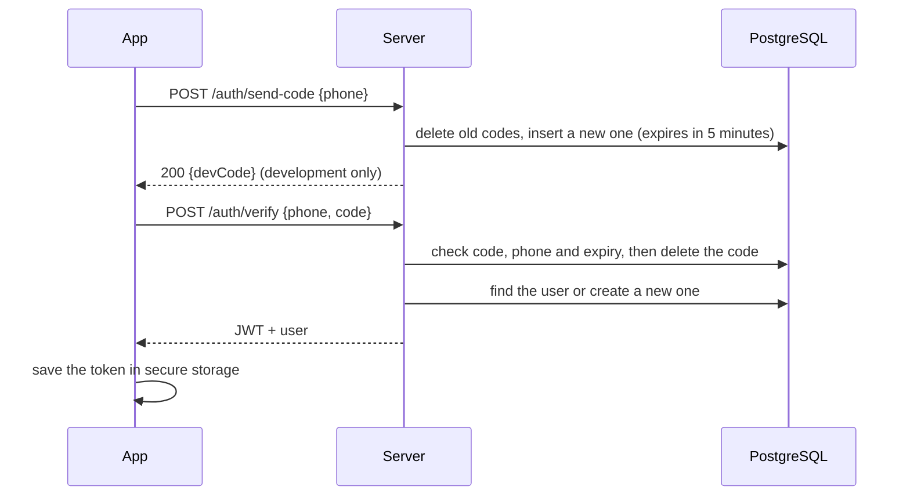

<div align="center">

# Yakkity

**A phone-number messenger built end to end in Dart: a Flutter client and a Flint Dart server.**

**English** · [Русский](README.ru.md)

</div>

<!--
  PREVIEW SLOTS
  Put your screenshots (desktop format, 16:9, for example 1600x900) into docs/images/ under these names:
    preview-1-light.png   preview-1-dark.png
    preview-2-light.png   preview-2-dark.png
  GitHub shows the "-dark" file to visitors with the dark theme and the "-light" file to everyone else,
  so each slot switches by itself, the same way the language link switches the README.
  If you have only one picture per slot, save a copy of it under both names.
-->

<p align="center">
  
  <br><br>
  
  <br><br>
  
</p>

## Contents

- [About](#about)
- [Features](#features)
- [Tech stack](#tech-stack)
- [Architecture](#architecture)
- [How sign-in works and how the code arrives](#how-sign-in-works-and-how-the-code-arrives)
- [How messages travel](#how-messages-travel)
- [API reference](#api-reference)
- [Project structure](#project-structure)
- [Getting started](#getting-started)
- [Configuration](#configuration)
- [Demo mode and demo files](#demo-mode-and-demo-files)
- [Tests](#tests)
- [Design decisions](#design-decisions)
- [Known limitations and roadmap](#known-limitations-and-roadmap)

## About

Yakkity is a portfolio project: a small Telegram-like messenger. Its main goal is to show a complete, realistic
stack with one language on both sides: a real server with a database, authentication, real-time messaging
and a client that keeps working without a network.

It is not a finished product. Calls and contacts are placeholders, and SMS delivery is replaced by a development
shortcut (see [below](#how-sign-in-works-and-how-the-code-arrives)). The [limitations](#known-limitations-and-roadmap)
section lists everything honestly.

## Features

**Client (Flutter)**

- Sign in by phone number with a one-time code, no passwords and no e-mail.
- First-run screen to set your display name; automatic sign-in on the next launch.
- Chat list built from the local database: last message, time, unread counters, unread filter,
  search across contacts and message texts, and "write to a phone number" straight from the search field.
- Chat screen: date separators ("Today", "Yesterday", "5 November"), grouped messages, message tails,
  delivery states (sending, sent, failed), tap-to-retry, an offline banner and an emoji panel.
- **Offline-first**: the screens read only the local database, the network just writes into it.
  Messages written without a connection are kept and sent automatically when the connection returns.
- Profile: display name and status (tap the text to edit; long text wraps and stays centered),
  emoji in the status, a photo stored on the device, message statistics, light/dark theme switch
  (the choice is remembered), notification preference, sign out.
- Light and dark themes in the same red accent; animated floating-shapes background on the sign-in screens,
  every parameter of which lives in one settings block ([`BackgroundSettings`](client/lib/core/widgets/animated_background.dart)).
- Demo mode with fictional contacts for screenshots and previews.

**Server (Flint Dart)**

- One-time codes with a five-minute lifetime, JWT sessions (one hour), parameterized SQL everywhere.
- WebSocket gateway: every user has a personal room, messages are saved first and delivered second.
- Idempotent sending: a retried message is never stored twice.
- Message history and user lookup endpoints.

## Tech stack

| Part | Technology |
| --- | --- |
| Client | Flutter, Dart, `flutter_bloc` (Cubit), `equatable`, `dio`, `get_it`, `web_socket_channel`, `flutter_secure_storage`, `sembast` (+ `sembast_web`), `image_picker` |
| Server | Dart, [Flint Dart](https://pub.dev/packages/flint_dart) 1.5, WebSocket, JWT |
| Database | PostgreSQL (in Docker) on the server; sembast (a pure-Dart NoSQL store) on the device |
| Tooling | Docker, `flint` CLI, VS Code tasks, PowerShell helper script |

The client runs in Chrome and on Android with the same code. sembast was chosen because it works in the browser
and on a phone without native plugins.

## Architecture

The key idea: **the UI never talks to the network.** It listens to the local database; the network layer only writes
into it. This gives instant screens, offline reading, and one source of truth.



Client layers per feature: `data` (repositories, local stores) → `cubit` (state) → `ui` (widgets).
Objects such as Dio, the database and the repositories are created once and handed out by `get_it`.

## How sign-in works and how the code arrives



Step by step:

1. The user enters a phone number. The server normalizes it (spaces, dashes and brackets are removed) and
   accepts 8 to 15 digits with an optional leading `+`.
2. The server generates a **six-digit code** with a cryptographically secure random generator, deletes any older codes
   for that number, and stores the new one with an expiry of **five minutes**.
3. **How the code reaches you in this project.** There is no SMS gateway, because it costs money and a portfolio
   project does not need one. Instead, in development the server **prints the code to its console** and also returns
   it in the response as `devCode`; the app shows it on the code screen under "Code for development".
   For production the plan is: plug in an SMS provider in `sendCode()` and remove `devCode` from the response.
4. The user enters the code. The server accepts it only if the phone matches, the code matches and it has not expired,
   and then **deletes it, so a code works exactly once**.
5. The server finds the user by phone or creates a new account (sign-in and sign-up are the same flow) and issues a
   JWT valid for **one hour**.
6. The app keeps the token in secure storage. A Dio interceptor adds `Authorization: Bearer <token>` to every request.
   When the server answers 401 on a protected route, the interceptor clears the token and signals the app, which
   returns to the sign-in screen with "Session expired". The WebSocket reacts to a rejected token in the same way.

## How messages travel

1. The user presses send. The app creates a message with a locally generated unique `clientId` and status
   **pending**, writes it to the local database, and it appears on screen at once.
2. The message goes over the WebSocket as `send_message {to, text, clientId}`.
3. The server validates it (recipient exists, text up to 2000 characters), **saves it to PostgreSQL first**, then pushes it
   to the recipient's personal room `user:<id>`, and confirms to the sender with `message_sent` carrying the same `clientId`.
4. On confirmation the app replaces the pending record with the server's one (adds the server id and time): status **sent**.
5. If there is no connection, or no confirmation arrives within ten seconds, the message becomes **failed** and shows
   a "tap to retry" hint. When the connection returns, all unsent messages are sent again automatically.
6. A unique index on `(sender_id, client_id)` makes retries safe: the server recognizes a repeated `clientId`,
   does not store a duplicate, and simply confirms again.
7. The WebSocket reconnects by itself with growing pauses (1, 2, 4, 8, 16, then 30 seconds).
8. When a chat opens, the history is requested from the server and merged into the local database;
   records are matched by server id, so nothing is duplicated.

## API reference

All routes except the first two require `Authorization: Bearer <token>`.

| Method | Route | Purpose |
| --- | --- | --- |
| `POST` | `/auth/send-code` | Body `{phone}`. Creates a one-time code. |
| `POST` | `/auth/verify` | Body `{phone, code}`. Returns `{token, user}`. |
| `GET` | `/auth/me` | Current user (`id`, `phone`, `name`, `status`). |
| `PUT` | `/auth/profile` | Body `{name?, status?}`. Name up to 50 characters, status up to 100 (emoji count as one). An empty status clears it. |
| `GET` | `/chat/users/lookup?phone=` | Find a user by phone number. |
| `GET` | `/chat/peers/:id` | Name, phone and status of a user by id. |
| `GET` | `/chat/messages/:userId?limit=` | Conversation with a user, newest first (limit 1 to 100, default 50). |
| `WS` | `/ws/chat?token=<jwt>` | Real-time channel. |

The token goes in the query string for the WebSocket because browsers cannot set headers on WebSocket connections.

WebSocket messages are JSON: `{"event": "...", "data": {...}}`.

| Direction | Event | Data |
| --- | --- | --- |
| client → server | `send_message` | `{to, text, clientId}` |
| server → client | `connected` | `{userId}` |
| server → client | `new_message` | the saved message |
| server → client | `message_sent` | the saved message plus the original `clientId` |
| server → client | `error` | `{message}` |

## Project structure

```
Yakkity/
├── backend/                     Flint Dart server
│   ├── lib/
│   │   ├── main.dart            app setup, CORS, routes, WebSocket
│   │   ├── config/              table registry for migrations
│   │   ├── controllers/         auth_controller, chat_controller
│   │   ├── middlewares/         auth_middleware (JWT check)
│   │   ├── models/              user, message, verification_code
│   │   ├── routes/              app_routes, auth_routes, chat_routes
│   │   └── sockets/             chat_socket (WebSocket gateway)
│   └── .env.example
├── client/                      Flutter app
│   ├── assets/demo/             photos for the demo contacts
│   ├── lib/
│   │   ├── main.dart, di.dart
│   │   ├── core/                config, network (Dio, WebSocket), storage, theme, utils, widgets
│   │   └── features/            auth, chat, profile, home, demo
│   └── test/                    unit tests
├── docs/images/                 README screenshots
├── dev.ps1                      Windows helper: starts Docker, the database and the server
└── .vscode/tasks.json           starts the backend when the folder is opened
```

## Getting started

**You need:** [Flutter](https://docs.flutter.dev/get-started/install) (it includes Dart), Docker Desktop, and the
Flint CLI: `dart pub global activate flint_dart`.

### 1. Database

```bash
docker run --name messenger-db -e POSTGRES_PASSWORD=password -e POSTGRES_DB=messenger -p 5432:5432 -d postgres
docker update --restart unless-stopped messenger-db
```

### 2. Server

```bash
cd backend
cp .env.example .env        # then set your own JWT_SECRET
flint migrate               # creates the tables
flint run                   # http://localhost:3000
```

Quick check: opening `http://localhost:3000` returns `{"status":"ok","service":"messenger-backend"}`.

If you created the database earlier, before the `name`, `status` and `client_id` columns existed, add them by hand:

```sql
ALTER TABLE users ADD COLUMN IF NOT EXISTS name VARCHAR(50);
ALTER TABLE users ADD COLUMN IF NOT EXISTS status VARCHAR(100);
ALTER TABLE messages ADD COLUMN IF NOT EXISTS client_id VARCHAR(64);
CREATE UNIQUE INDEX IF NOT EXISTS messages_sender_client_uq ON messages (sender_id, client_id);
```

On Windows, `powershell -ExecutionPolicy Bypass -File .\dev.ps1` does everything in this section for you, and the included
VS Code task runs it whenever the folder is opened.

### 3. Client

```bash
cd client
flutter pub get
flutter run -d chrome --web-port 5000
```

Use a **fixed port**: the browser stores the local database per address, so a random port would look like a new,
empty device on every launch.

To chat with yourself, run a second client: `flutter run -d web-server --web-port 5001` and open
`http://localhost:5001` in a private window. Sign in with two different phone numbers. The code is printed in the server
console and shown on the code screen.

**Android phone over USB** (no Wi-Fi needed):

```bash
adb reverse tcp:3000 tcp:3000
flutter run -d <device-id>
```

`adb reverse` makes the phone's `localhost:3000` point to your computer and has to be repeated after every reconnect.
The Android manifest needs the `INTERNET` permission, and for development `android:usesCleartextTraffic="true"`
(plain `http://`). Over Wi-Fi, pass your computer's address instead: `--dart-define=API_HOST=192.168.x.x`
and allow port 3000 in the firewall.

## Configuration

| Where | What |
| --- | --- |
| `backend/.env` | `PORT`, `DB_CONNECTION=postgres`, `DB_HOST`, `DB_PORT`, `DB_NAME`, `DB_USER`, `DB_PASSWORD`, `JWT_SECRET`. The real `.env` is git-ignored; `.env.example` shows the keys. |
| [`AppConfig`](client/lib/core/config/app_config.dart) | Server address. `localhost` by default; override with `--dart-define=API_HOST=...`. |
| [`BackgroundSettings`](client/lib/core/widgets/animated_background.dart) | Number, size, opacity, colors, speed and kinds of the floating shapes. Change a value and do a hot **restart** (`R`). |
| [`AppTheme`](client/lib/core/theme/app_theme.dart) | Light and dark color schemes. |

## Demo mode and demo files

For screenshots, videos and previews the app can fill itself with ten fictional contacts. Open the **Profile** tab and turn on
**Demo data** (section "FOR PREVIEW"). Everything is stored only on the device: nothing is sent to the server, real
conversations are not touched, and the switch removes the demo data again.

The contacts have different "ages" so that the chat list looks alive: some wrote just now and have unread messages, some
wrote yesterday, some weeks ago. Writing to a demo contact works: the message is delivered at once and the contact answers
a couple of seconds later with a ready-made phrase.

| Photo | Contact | Last activity | Unread |
| --- | --- | --- | --- |
| `avatar_01` | Максим Громов | just now | 2 |
| `avatar_02` | Екатерина Волкова | recently | 1 |
| `avatar_03` | Артём Николаев | yesterday | 0 |
| `avatar_04` | Ольга Ковалева | 4 days ago | 0 |
| `avatar_05` | Дамир Сатыбалдиев | 8 days ago | 0 |
| `avatar_06` | Айгуль Токтосунова | 12 days ago | 0 |
| `avatar_07` | Игорь Петров | 19 days ago | 0 |
| `avatar_08` | Алина Смирнова | just now, long status | 3 |
| `avatar_09` | Александр Константинович Вознесенский-Ростовцев | a month ago, very long name | 0 |
| `avatar_10` | Мама ❤️ | today | 0 |

The two long texts are deliberate: they check that names and statuses wrap correctly.

Files involved:

| File | Role |
| --- | --- |
| [`client/assets/demo/avatar_01.jpg … avatar_10.jpg`](client/assets/demo) | Contact photos. Add your own pictures under these names (square, about 256 × 256). A missing file simply shows the first letter of the name. |
| [`demo_data.dart`](client/lib/features/demo/demo_data.dart) | The contacts, their statuses and message scripts. `photoExtension` switches `jpg` to `png`. |
| [`demo_service.dart`](client/lib/features/demo/demo_service.dart) | Turns the demo on and off: writes and removes demo records in the local database. |
| `client/assets/demo/README.txt` | Which photo number belongs to whom. |

Demo contacts use ids from 9001 up, which real users never have.

## Tests

```bash
cd client
flutter analyze
flutter test
```

| File | Tests | What it covers |
| --- | --- | --- |
| `local_message_store_test.dart` | 4 | A pending message becomes sent after confirmation; history does not duplicate a confirmed message; conversations are separated and sorted newest first; the unsent list contains only pending and failed messages. |
| `date_format_test.dart` | 3 | "Today", "Yesterday" and full dates; comparing calendar days. |
| `demo_service_test.dart` | 6 | Enabling fills the list with every demo contact; unread counters match the script; ordering by freshness; disabling removes everything; real chats stay untouched; enabling twice creates no duplicates. |
| `text_limits_test.dart` | 7 | The length limiter counts real characters (an emoji is one); cutting long text; inserting an emoji at the cursor, over a selection and with a limit. |

The tests use an in-memory sembast database, so they run in seconds without a server or a device.
The server has no automated tests yet; it has been checked by hand with PowerShell requests and a WebSocket client.

## Design decisions

- **Cubit instead of a heavier state manager.** Each screen has a small state class and a few methods; streams from the
  database feed the state. This keeps the logic easy to read and test.
- **Repository + local database as the single source of truth.** Screens never mix network and cache logic.
- **Idempotent writes.** The client-generated `clientId` plus a unique index make retries harmless.
- **Persist first, deliver second.** A message is saved on the server before anyone is told about it, so a crash
  cannot lose a message that was already delivered.
- **Expiring sessions are a normal case.** One interceptor handles an expired token for the whole app.
- **Parameterized SQL** everywhere; user-supplied values never become part of a query string.
- **Limits count real characters.** Name and status lengths are measured in characters (code points) on both sides,
  so emoji cannot slip past one side's check.
- **Accessibility of motion.** The animated background stops when the system "reduce animations" setting is on.

## Known limitations and roadmap

- SMS delivery is simulated (`devCode`). A provider has to be connected before a real launch, and requests for codes
  need rate limiting.
- The profile photo is stored only on the device. Showing it to other people needs file upload and storage on the server.
- "Read" marks (unread counters) are kept on the device, so another device starts from scratch.
- The notifications checkbox saves a preference; real push notifications are not implemented.
- The chat list is built from the local database. A server endpoint returning the list of conversations would
  restore it on a new device.
- Calls and contacts tabs are placeholders.
- CORS is open to every origin and plain `http://` is allowed: both are development settings.
- Server tests and a CI pipeline are still to be added; the server also contains some unused Flint template files.

## License

Portfolio and learning project. Use the code for reference as you like.
