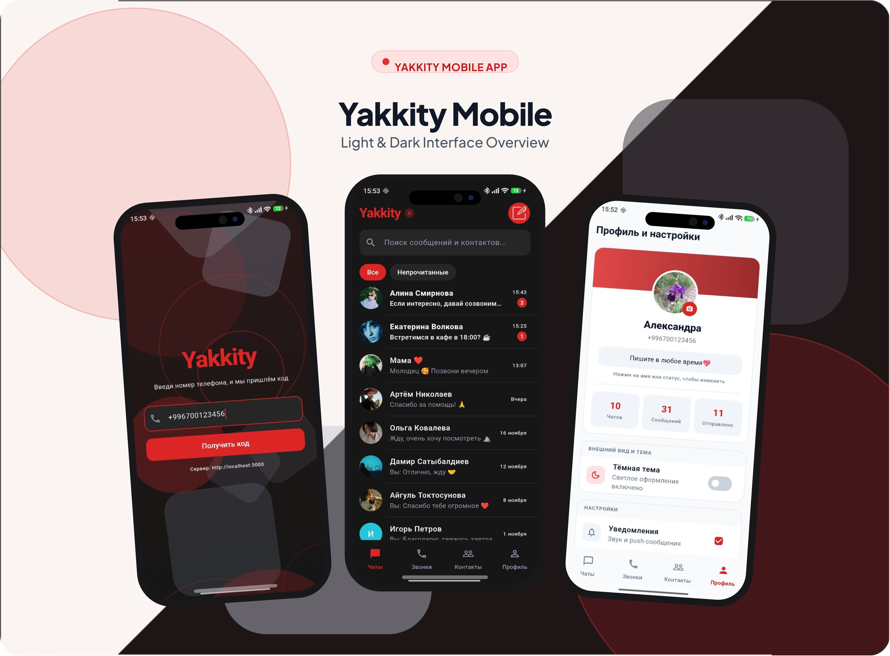
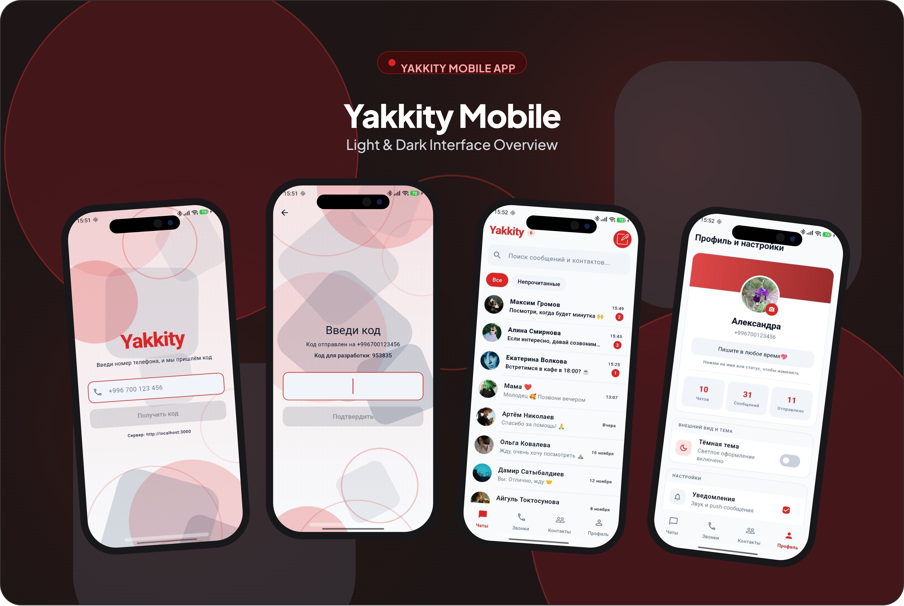
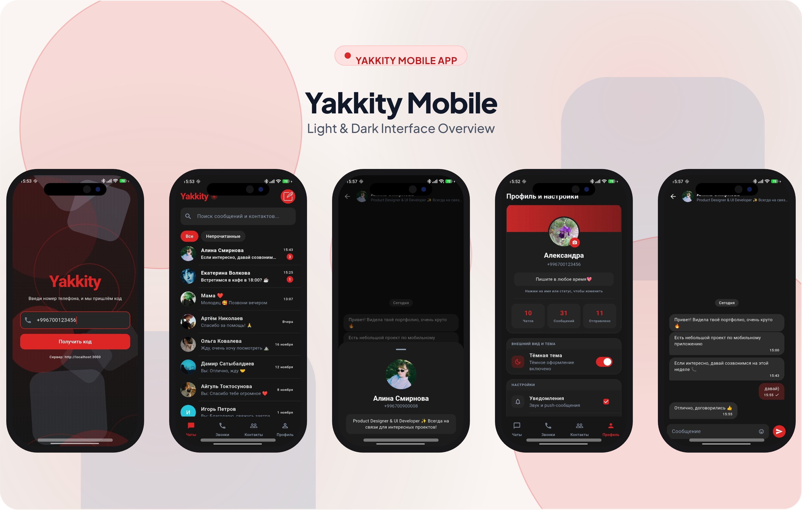
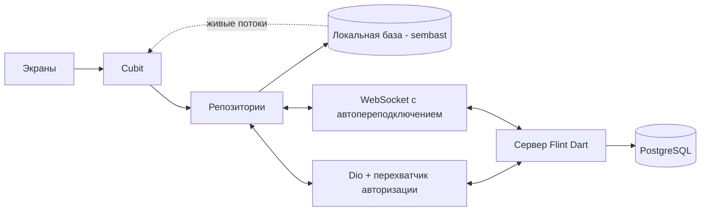
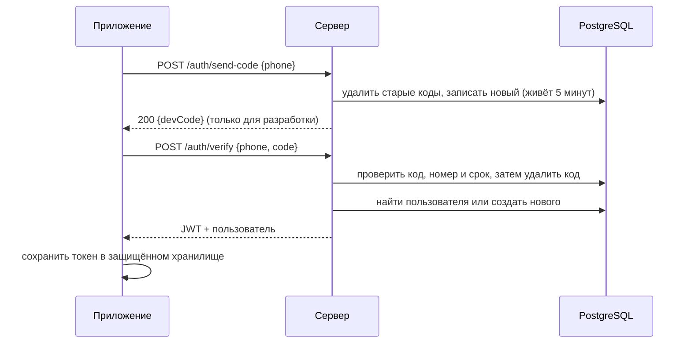

<div align="center">

# Yakkity

**Мессенджер с входом по номеру телефона, написанный целиком на Dart: клиент на Flutter и сервер на Flint Dart.**

[English](README.md) · **Русский**

</div>

<!--
  СЛОТЫ ПОД КАРТИНКИ
  Положи скриншоты (формат экрана ПК, 16:9, например 1600x900) в docs/images/ под такими именами:
    preview-1-light.png   preview-1-dark.png
    preview-2-light.png   preview-2-dark.png
  GitHub показывает файл с «-dark» тем, у кого тёмная тема, а с «-light» всем остальным.
  Так каждый слот переключается сам, как ссылка языка переключает README.
  Если у тебя одна картинка на слот, сохрани её копию под обоими именами.
-->

<p align="center">
  
  <br><br>
  
  <br><br>
  
</p>

## Демо

<div align="center">
  <video src="https://github.com/user-attachments/assets/d0e20ee8-71bb-41f5-bcd2-f001b0775382" controls width="570"></video>
</div>


## О проекте

Yakkity: учебный проект для портфолио, небольшой мессенджер в духе Telegram. Его главная цель: показать целостный и
реалистичный стек с одним языком на обеих сторонах: настоящий сервер с базой данных, авторизацию, сообщения в реальном
времени и клиент, который продолжает работать без сети.

Это не готовый продукт. Звонки и контакты пока заглушки, а отправка SMS заменена вариантом для разработки. Все ограничения честно перечислены в разделе
«Ограничения и планы».

## Возможности

**Клиент (Flutter)**

- Вход по номеру телефона с одноразовым кодом: без паролей и без почты.
- Экран знакомства при первом входе (имя); автоматический вход при следующем запуске.
- Список чатов строится из локальной базы: последнее сообщение, время, счётчики непрочитанных, фильтр «Непрочитанные»,
  поиск по контактам и по тексту сообщений и возможность «написать на номер» прямо из строки поиска.
- Экран чата: разделители дат («Сегодня», «Вчера», «5 ноября»), группировка сообщений, «хвостики» пузырей,
  статусы доставки (отправляется, отправлено, не отправлено), повтор по нажатию, плашка отсутствия связи и панель смайликов.
- **Offline-first**: экраны читают только локальную базу, а сеть лишь записывает в неё данные. Сообщения, написанные без
  связи, сохраняются и уходят сами, когда связь появляется.
- Профиль: имя и статус (нажми на текст, чтобы изменить; длинный текст переносится и остаётся по центру), смайлики в статусе,
  фото на устройстве, статистика сообщений, переключатель светлой и тёмной темы (выбор запоминается), настройка
  уведомлений, выход.
- Светлая и тёмная темы с одним красным акцентом; фон с плавающими фигурами на экранах входа, все параметры которого
  собраны в одном блоке настроек ([`BackgroundSettings`](client/lib/core/widgets/animated_background.dart)).
- Демо-режим с вымышленными контактами для скриншотов и превью.

**Сервер (Flint Dart)**

- Одноразовые коды на пять минут, сессии JWT на один час, везде параметризованные SQL-запросы.
- WebSocket-шлюз: у каждого пользователя своя комната, сообщение сначала сохраняется, потом доставляется.
- Идемпотентная отправка: повторно отправленное сообщение никогда не сохраняется дважды.
- Эндпоинты истории сообщений и поиска пользователя.

## Технологии

| Часть | Технологии |
| --- | --- |
| Клиент | Flutter, Dart, `flutter_bloc` (Cubit), `equatable`, `dio`, `get_it`, `web_socket_channel`, `flutter_secure_storage`, `sembast` (+ `sembast_web`), `image_picker` |
| Сервер | Dart, [Flint Dart](https://pub.dev/packages/flint_dart) 1.5, WebSocket, JWT |
| База данных | PostgreSQL (в Docker) на сервере; sembast (NoSQL-хранилище на чистом Dart) на устройстве |
| Инструменты | Docker, CLI `flint`, задачи VS Code, вспомогательный скрипт PowerShell |

Клиент работает в Chrome и на Android с одним и тем же кодом. sembast выбран потому, что он работает и в браузере,
и на телефоне без нативных плагинов.

## Архитектура

Главная идея: **интерфейс никогда не обращается к сети напрямую.** Он слушает локальную базу, а сетевой слой только
пишет в неё. Благодаря этому экраны открываются мгновенно, данные читаются без сети, а источник правды один.



Слои клиента внутри каждой функции: `data` (репозитории, локальные хранилища) → `cubit` (состояние) → `ui` (виджеты).
Объекты вроде Dio, базы и репозиториев создаются один раз и выдаются через `get_it`.

## Как работает вход и как приходит код



Шаг за шагом:

1. Пользователь вводит номер телефона. Сервер приводит его к единому виду (убирает пробелы, дефисы и скобки) и принимает
   от 8 до 15 цифр с необязательным `+` в начале.
2. Сервер генерирует **шестизначный код** криптографически стойким генератором случайных чисел, удаляет старые коды для
   этого номера и сохраняет новый со сроком жизни **пять минут**.
3. **Как код доходит до тебя в этом проекте.** SMS-шлюза нет: он платный, а для портфолио не нужен. Вместо этого в режиме
   разработки сервер **печатает код в своей консоли** и дополнительно возвращает его в ответе как `devCode`; приложение
   показывает его на экране ввода кода под надписью «Код для разработки». Для настоящего запуска план такой: подключить
   SMS-провайдера в методе `sendCode()` и убрать `devCode` из ответа.
4. Пользователь вводит код. Сервер принимает его, только если совпали номер и код и срок не истёк, а затем **удаляет,
   поэтому код работает ровно один раз**.
5. Сервер находит пользователя по номеру или создаёт новый аккаунт (вход и регистрация это один и тот же процесс) и
   выдаёт JWT на **один час**.
6. Приложение хранит токен в защищённом хранилище. Перехватчик Dio добавляет `Authorization: Bearer <token>` в каждый запрос.
   Если сервер отвечает 401 на защищённый маршрут, перехватчик стирает токен и сообщает приложению, которое возвращается
   на экран входа с надписью «Сессия истекла». WebSocket так же реагирует на отклонённый токен.

## Как путешествует сообщение

1. Пользователь нажимает «отправить». Приложение создаёт сообщение с уникальным `clientId`, сгенерированным на устройстве,
   и статусом **pending** (отправляется), записывает его в локальную базу, и оно сразу появляется на экране.
2. Сообщение уходит по WebSocket как `send_message {to, text, clientId}`.
3. Сервер проверяет его (получатель существует, текст до 2000 символов), **сначала сохраняет в PostgreSQL**, потом
   отправляет в личную комнату получателя `user:<id>` и подтверждает отправителю событием `message_sent` с тем же `clientId`.
4. Получив подтверждение, приложение заменяет временную запись серверной (добавляются id и время сервера): статус **sent**.
5. Если связи нет или подтверждение не пришло за десять секунд, сообщение становится **failed** с подсказкой «Нажми,
   чтобы повторить». Когда связь возвращается, все неотправленные сообщения уходят снова автоматически.
6. Уникальный индекс по `(sender_id, client_id)` делает повторы безопасными: сервер узнаёт знакомый `clientId`, не
   сохраняет дубль и просто подтверждает снова.
7. WebSocket переподключается сам с растущими паузами (1, 2, 4, 8, 16, затем 30 секунд).
8. При открытии чата история запрашивается с сервера и объединяется с локальной базой; записи сопоставляются по серверному
   id, поэтому дублей не возникает.

## Справочник API

Все маршруты, кроме первых двух, требуют заголовок `Authorization: Bearer <token>`.

| Метод | Маршрут | Назначение |
| --- | --- | --- |
| `POST` | `/auth/send-code` | Тело `{phone}`. Создаёт одноразовый код. |
| `POST` | `/auth/verify` | Тело `{phone, code}`. Возвращает `{token, user}`. |
| `GET` | `/auth/me` | Текущий пользователь (`id`, `phone`, `name`, `status`). |
| `PUT` | `/auth/profile` | Тело `{name?, status?}`. Имя до 50 символов, статус до 100 (смайлик считается за один). Пустой статус стирает его. |
| `GET` | `/chat/users/lookup?phone=` | Найти пользователя по номеру. |
| `GET` | `/chat/peers/:id` | Имя, номер и статус пользователя по id. |
| `GET` | `/chat/messages/:userId?limit=` | Переписка с пользователем, новые сообщения первыми (limit от 1 до 100, по умолчанию 50). |
| `WS` | `/ws/chat?token=<jwt>` | Канал реального времени. |

Для WebSocket токен передаётся в строке адреса, потому что браузер не умеет добавлять заголовки к WebSocket-соединению.

Сообщения WebSocket это JSON: `{"event": "...", "data": {...}}`.

| Направление | Событие | Данные |
| --- | --- | --- |
| клиент → сервер | `send_message` | `{to, text, clientId}` |
| сервер → клиент | `connected` | `{userId}` |
| сервер → клиент | `new_message` | сохранённое сообщение |
| сервер → клиент | `message_sent` | сохранённое сообщение и исходный `clientId` |
| сервер → клиент | `error` | `{message}` |

## Структура проекта

```
Yakkity/
├── backend/                     сервер на Flint Dart
│   ├── lib/
│   │   ├── main.dart            настройка приложения, CORS, маршруты, WebSocket
│   │   ├── config/              реестр таблиц для миграций
│   │   ├── controllers/         auth_controller, chat_controller
│   │   ├── middlewares/         auth_middleware (проверка JWT)
│   │   ├── models/              user, message, verification_code
│   │   ├── routes/              app_routes, auth_routes, chat_routes
│   │   └── sockets/             chat_socket (WebSocket-шлюз)
│   └── .env.example
├── client/                      приложение на Flutter
│   ├── assets/demo/             фото демо-контактов
│   ├── lib/
│   │   ├── main.dart, di.dart
│   │   ├── core/                config, network (Dio, WebSocket), storage, theme, utils, widgets
│   │   └── features/            auth, chat, profile, home, demo
│   └── test/                    модульные тесты
├── docs/images/                 скриншоты для README
├── dev.ps1                      помощник для Windows: запускает Docker, базу и сервер
└── .vscode/tasks.json           запускает бэкенд при открытии папки
```

## Запуск

**Нужно:** [Flutter](https://docs.flutter.dev/get-started/install) (Dart входит в комплект), Docker Desktop и CLI Flint:
`dart pub global activate flint_dart`.

### 1. База данных

```bash
docker run --name messenger-db -e POSTGRES_PASSWORD=password -e POSTGRES_DB=messenger -p 5432:5432 -d postgres
docker update --restart unless-stopped messenger-db
```

### 2. Сервер

```bash
cd backend
cp .env.example .env        # затем впиши свой JWT_SECRET
flint migrate               # создаёт таблицы
flint run                   # http://localhost:3000
```

Быстрая проверка: адрес `http://localhost:3000` возвращает `{"status":"ok","service":"messenger-backend"}`.

Если база была создана раньше, до появления колонок `name`, `status` и `client_id`, добавь их вручную:

```sql
ALTER TABLE users ADD COLUMN IF NOT EXISTS name VARCHAR(50);
ALTER TABLE users ADD COLUMN IF NOT EXISTS status VARCHAR(100);
ALTER TABLE messages ADD COLUMN IF NOT EXISTS client_id VARCHAR(64);
CREATE UNIQUE INDEX IF NOT EXISTS messages_sender_client_uq ON messages (sender_id, client_id);
```

В Windows команда `powershell -ExecutionPolicy Bypass -File .\dev.ps1` делает всё из этого раздела сама, а приложенная задача
VS Code запускает её при открытии папки.

### 3. Клиент

```bash
cd client
flutter pub get
flutter run -d chrome --web-port 5000
```

Используй **фиксированный порт**: браузер хранит локальную базу отдельно для каждого адреса, и случайный порт на
каждом запуске выглядел бы как новое пустое устройство.

Чтобы переписываться самой с собой, запусти второй клиент: `flutter run -d web-server --web-port 5001` и открой
`http://localhost:5001` в приватном окне. Войди с двумя разными номерами. Код печатается в консоли сервера и
показывается на экране ввода кода.

**Телефон на Android по USB** (Wi-Fi не нужен):

```bash
adb reverse tcp:3000 tcp:3000
flutter run -d <id-устройства>
```

`adb reverse` делает так, что `localhost:3000` на телефоне указывает на твой компьютер; команду нужно повторять после
каждого переподключения кабеля. Манифесту Android нужны разрешение `INTERNET` и для разработки
`android:usesCleartextTraffic="true"` (обычный `http://`). По Wi-Fi вместо этого передай адрес компьютера:
`--dart-define=API_HOST=192.168.x.x` и разреши порт 3000 в брандмауэре.

## Настройки

| Где | Что |
| --- | --- |
| `backend/.env` | `PORT`, `DB_CONNECTION=postgres`, `DB_HOST`, `DB_PORT`, `DB_NAME`, `DB_USER`, `DB_PASSWORD`, `JWT_SECRET`. Настоящий `.env` не попадает в Git; ключи показывает `.env.example`. |
| [`AppConfig`](client/lib/core/config/app_config.dart) | Адрес сервера. По умолчанию `localhost`; меняется через `--dart-define=API_HOST=...`. |
| [`BackgroundSettings`](client/lib/core/widgets/animated_background.dart) | Количество, размер, прозрачность, цвета, скорость и виды плавающих фигур. Поменяй значение и сделай горячий **перезапуск** (`R`). |
| [`AppTheme`](client/lib/core/theme/app_theme.dart) | Светлая и тёмная цветовые схемы. |

## Демо-режим и демо-файлы

Для скриншотов, видео и превью приложение может заполнить себя десятью вымышленными контактами. Открой вкладку **«Профиль»**
и включи **«Демо-данные»** (раздел «ДЛЯ ПРЕВЬЮ»). Всё хранится только на устройстве: на сервер ничего не отправляется,
настоящие переписки не затрагиваются, а переключатель снова убирает демо-данные.

У контактов разный «возраст», чтобы список чатов выглядел живым: одни написали только что и у них есть непрочитанные,
другие вчера, третьи несколько недель назад. Писать демо-контактам можно: сообщение сразу «доставлено», а контакт отвечает
через пару секунд заготовленной фразой.

| Фото | Контакт | Последняя активность | Непрочитанных |
| --- | --- | --- | --- |
| `avatar_01` | Максим Громов | только что | 2 |
| `avatar_02` | Екатерина Волкова | недавно | 1 |
| `avatar_03` | Артём Николаев | вчера | 0 |
| `avatar_04` | Ольга Ковалева | 4 дня назад | 0 |
| `avatar_05` | Дамир Сатыбалдиев | 8 дней назад | 0 |
| `avatar_06` | Айгуль Токтосунова | 12 дней назад | 0 |
| `avatar_07` | Игорь Петров | 19 дней назад | 0 |
| `avatar_08` | Алина Смирнова | только что, длинный статус | 3 |
| `avatar_09` | Александр Константинович Вознесенский-Ростовцев | месяц назад, очень длинное имя | 0 |
| `avatar_10` | Мама ❤️ | сегодня | 0 |

Два длинных текста сделаны намеренно: они проверяют, что имена и статусы переносятся правильно.

Какие файлы за это отвечают:

| Файл | Роль |
| --- | --- |
| [`client/assets/demo/avatar_01.jpg … avatar_10.jpg`](client/assets/demo) | Фото контактов. Добавь свои картинки под этими именами (квадратные, около 256 × 256). Если файла нет, показывается первая буква имени. |
| [`demo_data.dart`](client/lib/features/demo/demo_data.dart) | Контакты, их статусы и сценарии переписки. `photoExtension` меняет `jpg` на `png`. |
| [`demo_service.dart`](client/lib/features/demo/demo_service.dart) | Включает и выключает демо: записывает и удаляет демо-записи в локальной базе. |
| `client/assets/demo/README.txt` | Какой номер фото кому принадлежит. |

У демо-контактов id начинаются с 9001, у настоящих пользователей таких не бывает.

## Тесты

```bash
cd client
flutter analyze
flutter test
```

| Файл | Тестов | Что проверяет |
| --- | --- | --- |
| `local_message_store_test.dart` | 4 | Временное сообщение становится отправленным после подтверждения; история не дублирует подтверждённое сообщение; переписки разделены и отсортированы от новых к старым; список неотправленных содержит только pending и failed. |
| `date_format_test.dart` | 3 | «Сегодня», «Вчера» и полные даты; сравнение календарных дней. |
| `demo_service_test.dart` | 6 | Включение заполняет список всеми демо-контактами; счётчики непрочитанных совпадают со сценарием; порядок по свежести; выключение убирает всё; настоящие чаты не затрагиваются; двойное включение не создаёт дублей. |
| `text_limits_test.dart` | 7 | Ограничитель длины считает настоящие символы (смайлик это один); обрезка длинного текста; вставка смайлика в позицию курсора, поверх выделения и с ограничением. |

Тесты используют базу sembast в памяти, поэтому выполняются за секунды без сервера и устройства.
Автоматических тестов сервера пока нет; он проверен вручную запросами из PowerShell и клиентом WebSocket.

## Принятые решения

- **Cubit вместо более тяжёлого менеджера состояния.** У каждого экрана небольшой класс состояния и несколько методов;
  потоки из базы питают состояние. Логику легко читать и тестировать.
- **Репозиторий и локальная база как единственный источник правды.** Экраны не смешивают логику сети и кэша.
- **Идемпотентная запись.** Сгенерированный на клиенте `clientId` вместе с уникальным индексом делает повторы безвредными.
- **Сначала сохранить, потом доставить.** Сообщение сохраняется на сервере раньше, чем о нём узнает кто-то ещё, поэтому
  сбой не может потерять уже доставленное сообщение.
- **Истёкшая сессия это обычный случай.** Один перехватчик обрабатывает просроченный токен для всего приложения.
- **Параметризованный SQL** везде; значения от пользователя никогда не становятся частью строки запроса.
- **Лимиты считаются по настоящим символам.** Длина имени и статуса измеряется в символах (кодовых точках) и на клиенте,
  и на сервере, поэтому смайлики не обходят проверку одной из сторон.
- **Доступность анимации.** Анимированный фон останавливается, если в системе включено «уменьшить анимацию».

## Ограничения и планы

- Отправка SMS имитируется (`devCode`). Перед настоящим запуском нужно подключить провайдера, а запросы кодов ограничить
  по частоте.
- Фото профиля хранится только на устройстве. Чтобы его видели другие, нужны загрузка файлов и хранилище на сервере.
- Отметки «прочитано» (счётчики непрочитанных) хранятся на устройстве, поэтому на другом устройстве всё начнётся с нуля.
- Галочка уведомлений сохраняет выбор; настоящих push-уведомлений нет.
- Список чатов строится из локальной базы. Эндпоинт сервера со списком переписок восстановил бы его на новом устройстве.
- Вкладки «Звонки» и «Контакты» заглушки.
- CORS открыт для любых источников и разрешён обычный `http://`: оба параметра для разработки.
- Тесты сервера и CI ещё предстоит добавить; в сервере также остались неиспользуемые файлы шаблона Flint.

## Лицензия

Учебный проект для портфолио. Код можно использовать как справочный материал.
